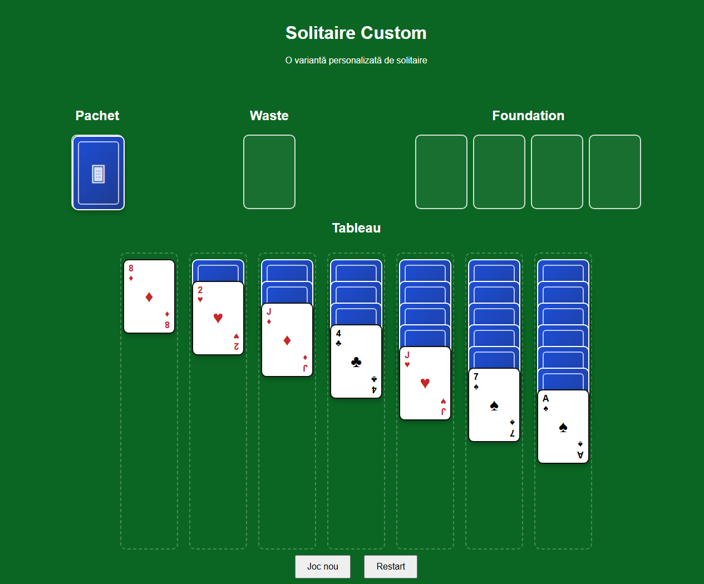

# Solitaire Custom

A browser-based Solitaire game built with HTML, CSS, and vanilla JavaScript. The game uses a green card table, custom card faces and backs, and a Romanian interface. It runs entirely in the browser with no build step or runtime dependencies.

## Live demo

**Placeholder:** Add the public demo URL here after deployment.

## Screenshots



**Additional screenshot placeholder:** Add a screenshot of a game in progress or the winning screen to `docs/screenshots/` and link it here.

## Features

- A shuffled 52-card deck and seven tableau columns.
- Draw-one stock with reusable waste cards.
- Drag individual cards or valid sequences between tableau columns.
- Move validation for descending ranks and alternating colors; empty columns accept kings.
- Four foundations built from ace to king in the same suit.
- Automatic reveal of newly exposed tableau cards.
- Valid drop targets highlighted while dragging.
- Foundation cards can move back to the tableau when the move is valid.
- **Joc nou** starts a newly shuffled game; **Restart** replays the current deal.
- A win message when all 52 cards reach the foundations, with a button to start another game.

## Tech stack

| Technology | Purpose |
| --- | --- |
| HTML5 | Page structure and game areas |
| CSS3 | Table layout, card styling, hover effects, and drag feedback |
| JavaScript | Deck generation, Fisher–Yates shuffle, game rules, DOM updates, and Pointer Events |
| Node.js built-in test runner | Optional browser regression checks |

Cards are rendered with CSS and Unicode symbols. No external fonts, image services, frameworks, or APIs are required to play.

## Local setup

Download the project and open `Solitaire-site.html` in a modern browser.

Alternatively, from the project directory, start a local server with Python 3:

```sh
python -m http.server 8000 --bind 127.0.0.1
```

Open [the local game](http://127.0.0.1:8000/Solitaire-site.html). Stop the server with `Ctrl+C`.

Keep the `Assets` directory alongside `Solitaire-site.html`. File and folder capitalization matters on case-sensitive servers.

## How to play

1. Click the stock under **Pachet** to draw one card into the waste. When the stock is empty, click it to recycle the waste.
2. Drag face-up cards onto a tableau card of the opposite color and one rank higher. Valid descending sequences can move together.
3. Move kings, or sequences beginning with a king, into empty tableau columns.
4. Move aces to empty foundations, then build each foundation upward in the same suit.
5. Complete all four foundations to win.

Progress is held in memory. Reloading the page starts a new game.

## Project structure

```text
.
├── Solitaire-site.html       # Game page
├── Assets/
│   ├── style.css             # Original visual design and card styles
│   └── script.js             # Gameplay and pointer interactions
├── docs/
│   └── screenshots/
│       └── gameplay.png      # Game preview
├── tests/
│   ├── browser.cjs           # Local Chromium test helper
│   └── game.test.cjs         # Gameplay regression checks
├── .gitignore
└── README.md
```

## Verification

There is no build step. Check JavaScript syntax with Node.js:

```sh
node --check Assets/script.js
```

Run browser regression checks with Node.js 22 or later and a locally installed Chrome, Edge, or Chromium:

```sh
node --test tests/game.test.cjs
```

The runner finds common browser installations automatically. If needed, set `BROWSER_PATH` to the browser executable. For example, in PowerShell:

```powershell
$env:BROWSER_PATH = 'C:\path\to\chrome.exe'
node --test tests/game.test.cjs
```

In a restricted execution environment where Chromium cannot start its renderer sandbox, set `BROWSER_NO_SANDBOX=1` for this local test run. The tests serve only the three game files on a temporary loopback server and use a temporary browser profile.

The checks cover asset loading with exact path capitalization, the initial deal, stock recycling, legal and illegal moves, automatic card reveals, foundations, interrupted drags, restart, new game, and the winning screen. No npm packages are needed.

Validation was performed with Node.js 24 and headless Chromium on Windows. Firefox, Safari, physical touch devices, keyboard accessibility, and an end-to-end win through an entire shuffled deal have not been verified. The winning-screen check uses a prepared board. The existing layout is designed for desktop-sized screens.
